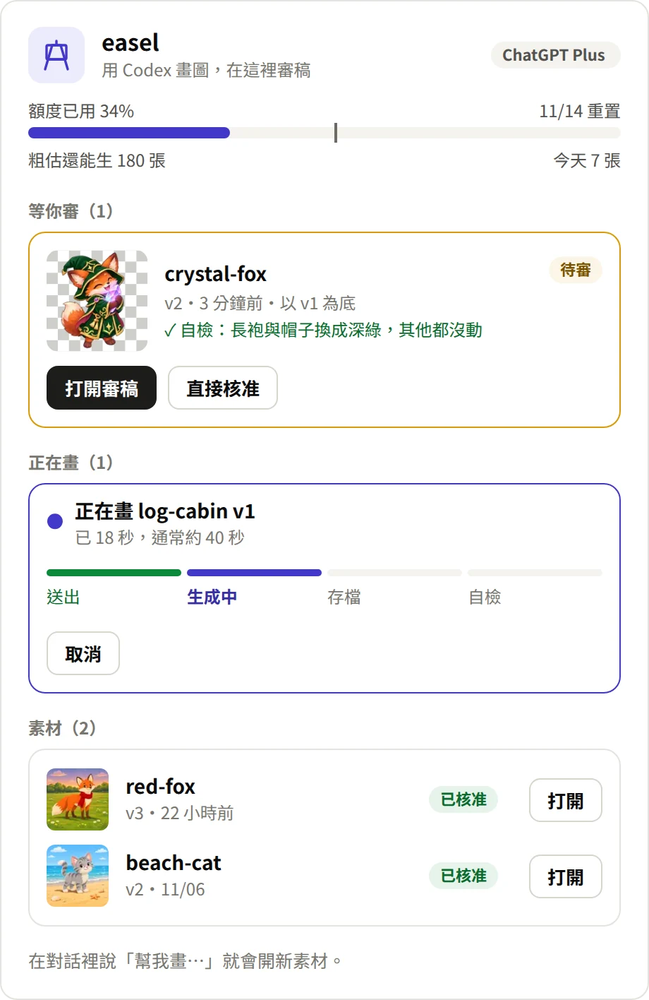

# easel

用官方 Codex 生圖，在 Claude Code 裡看圖、審稿與看額度。圖走你的 ChatGPT 訂閱額度，不需要 API key。

你在對話裡說「幫我畫一隻狐狸法師」，Claude 畫好後先自己看圖檢查，再交給你在面板上核准或要求修改。每個素材有自己的版本紀錄，改圖時接回同一段 Codex 對話，主體和構圖不會跑掉。

## 用起來長這樣

1. **說一句話。** 在對話裡告訴 Claude 想畫什麼，例如「幫我畫一隻抱著發光水晶的小狐狸法師，透明背景」。
2. **Claude 畫完先自己檢查。** 它看過圖、對照你的要求，再把結果和結論放上面板。
3. **你決定要不要。** 按核准，或直接打字說要改哪裡，下一版會以這一版為底。

<table>
<tr>
<td valign="top" width="50%">

**面板首頁**：額度、等你審的素材、正在畫的進度。

<picture>
  <source media="(prefers-color-scheme: dark)" srcset="docs/images/panel-home-dark.webp">
  
</picture>

**兩版並排**：只改圍巾，背景和姿勢都沒跑掉。

<picture>
  <source media="(prefers-color-scheme: dark)" srcset="docs/images/panel-compare-dark.webp">
  
</picture>

</td>
<td valign="top" width="50%">

**審稿**：大圖、版本條、Claude 的自檢結論，核准或打字要求修改。

<picture>
  <source media="(prefers-color-scheme: dark)" srcset="docs/images/panel-review-dark.webp">
  
</picture>

</td>
</tr>
</table>

<sub>圖裡的素材都是 Codex 實際畫出來的。畫面由面板本身的繪圖程式產生，按鈕與額度數字是示意。</sub>

## 安裝

**支援 Linux 與 Windows 的 WSL。** macOS 和 Windows 原生目前跑不起來，因為 easel 用到 GNU 版的 `find`、`base64`、`timeout`。

### 1. 先準備兩個工具

官方 [Codex CLI](https://github.com/openai/codex)：

```bash
curl -fsSL https://chatgpt.com/codex/install.sh | sh
```

`ffmpeg`，用來產生面板的縮圖：

```bash
sudo apt install ffmpeg
```

Codex 登入不用現在做，第一次打開面板時會帶你用裝置碼登入，手機也能完成。要先到 ChatGPT 的安全性設定開啟裝置碼登入，否則頁面會顯示沒有開啟。

### 2. 裝 easel

三種方式擇一，都不用改任何設定檔。

**A. 請 Claude 幫你裝**：在任何一個 Claude Code 對話（桌面 app 的 Code 分頁也可以）輸入：

> 請照 https://github.com/MiskaWu/easel README 的「給 Claude 的安裝步驟」幫我安裝

**B. 自己在終端機裝**（電腦上有 `claude` 指令的話）：

```bash
claude plugin marketplace add MiskaWu/easel && claude plugin install easel@easel
```

或在終端機版 Claude Code 的輸入框打 `/plugin install easel --marketplace MiskaWu/easel`，問 `Add marketplace?` 時回 `y`，範圍選 user。

**C. 桌面 app**（`/plugin` 在桌面 app 不能用）：按輸入框旁的 **+** → **Plugins** → **Add marketplace**，填 `MiskaWu/easel`，再 **Add plugin**。

### 3. 開始用

輸入 `/reload-plugins`（或開一個新對話）讓它生效，再輸入 `/easel` 打開面板。

### 更新

```bash
claude plugin marketplace update easel && claude plugin update easel@easel
```

或在 `/plugin` → **Marketplaces** → **easel** → **Enable auto-update** 打開自動更新。

### 給 Claude 的安裝步驟

照下面做，不要改 `settings.json`，也不要替使用者登入 Codex。

1. 確認是 Linux 或 WSL。macOS 或 Windows 原生就停下來，告訴使用者目前不支援。
2. 決定用哪個 `claude`：`command -v claude` 有結果就用它；沒有的話用環境變數 `$CLAUDE_CODE_EXECPATH`
   （目前這個 Claude Code 本身，桌面 app 的 Code 分頁裡也有）。以下記作 `$CLAUDE`。
3. 加入 marketplace：`"$CLAUDE" plugin marketplace add MiskaWu/easel`。
   已經加過的話改跑 `"$CLAUDE" plugin marketplace update easel`。
4. 安裝：`"$CLAUDE" plugin install easel@easel`。已經裝過的話改跑 `"$CLAUDE" plugin update easel@easel`。
5. 用 `"$CLAUDE" plugin list` 確認 `easel@easel` 是 enabled。
6. 檢查 `codex --version` 和 `ffmpeg -version`，缺哪個就把「先準備兩個工具」那段的指令給使用者。
7. 告訴使用者：先輸入 `/reload-plugins`（或開一個新對話），再輸入 `/easel` 打開面板並登入。

## 怎麼用

- **畫新圖：** 直接在對話裡說要畫什麼。遊戲角色、圖示這類要去背的，說要透明背景。
- **審稿：** `/easel` 面板列出等你審的素材，有版本條、兩版比較、核准與退回。
- **修改：** 在面板輸入想改什麼，或在對話裡說。一律以目前版本為底，要回到舊版也可以。
- **額度：** 面板頂端和右下角顯示 Codex 額度。張數是 easel 用本機的圖數估的，官方只給百分比，所以只能當粗估。

素材放在專案的 `art/<素材名>/`：`v1.png`、`v2.png` 與 `meta.json`。第一次畫圖時會放一份 `art/.gitignore`，把暫存與紀錄排除在版控之外。

## 它怎麼運作

easel 只執行官方 `codex`，不讀 `~/.codex/auth.json`，也不自己呼叫 API。執行時會清掉 `OPENAI_API_KEY`、`CODEX_API_KEY`，避免悄悄改走 API 計費。

有幾條規則來自實測，寫進了程式：

- **改圖一律附上底圖。** 模型拿對話裡最後看得到的圖當底，不一定是最新版。不附的話，背景曾從黃昏退回白天。
- **看生圖資料夾判定成功。** Codex 的事件紀錄沒有生圖項目，所以看 `~/.codex/generated_images/<對話編號>/` 有沒有多一張新圖；沒有就不算數。
- **透明要明講參數。** 提示詞沒寫 `transparent_background` 時，模型曾連續生出不透明的圖，白花額度。
- **尺寸和畫質只能寫在提示詞。** 內建工具沒有這兩個參數。

## 限制

- 只支援 Linux 與 WSL。
- 只能在 Claude Code 裡用，排程或純終端機叫不動。
- 手機面板沒有輸入框，想修改請在對話裡說。
- 官方的 `openai/codex-plugin-cc` 是程式碼審查與代辦用，跟 easel 可以並存。

## 開發

```bash
cd mod
claude plugin test .
claude plugin validate .
```

開發慣例見 [CLAUDE.md](CLAUDE.md)。

## 授權

MIT
